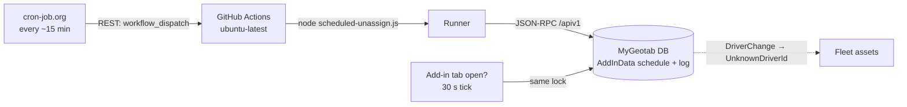
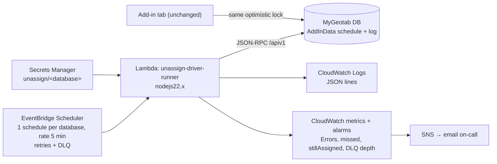

# Port plan: scheduled driver unassign → AWS Lambda + Amazon EventBridge

**Status:** legacy analysis. Investigated 2026-10-15 against `main` @ `3df2927`; the port it
describes has since been implemented on `aws-lambda-port` (see the repository README).
**Branch:** `aws-lambda-port` (created; both planning docs live here).
**Goal of this doc:** the legacy analysis — description, current state, review, invariants.

> **Planning authority has moved.** `docs/aws-port-implementation-prompt.md` is the implementation
> brief and supersedes §5 (decisions), §6 (architecture), §7 (phases), §8 (verification), §9 (open
> questions) and §10 (definition of done) below: the target design now stores runtime configuration
> in S3, schedules in EventBridge Scheduler per tenant database, and authorizes requests with the
> caller's live MyGeotab session instead of a shared service account. Read §1–§4 here for what the
> service is and the contracts that must not change; read the brief for what to build.

---

## 1. Project description

### 1.1 One-liners (repo / handoff use)

- **Repo description:** MyGeotab add-in plus off-browser scheduler that resets every asset in a fleet to *Unknown Driver* at a customer-set time.
- **Port project:** Replace the third-party cron trigger (cron-job.org) and GitHub Actions runner with an AWS Lambda function driven by Amazon EventBridge Scheduler, preserving the Geotab add-in, the schedule storage contract, and the exactly-once run semantics.

### 1.2 Product summary

"Scheduled Driver Unassign by Advantage One" is a single-file MyGeotab add-in (`unassignDrivers.html`, loaded from jsDelivr pinned to a release tag) that lets a fleet admin set a daily/weekly/one-time time at which every in-scope asset is reset to the **Unknown Driver**, so each shift starts clean and trips stop being credited to the previous driver. Three components:

1. **Add-in UI** (`unassignDrivers.html`, lines 752–1173) — schedule form, live preview of assigned drivers, manual "Unassign All Now", Run history table, service-account instructions. Administrator clearance required. It also runs the schedule itself while a tab is open (30 s tick), as a fallback.
2. **Core logic** (505 lines, duplicated verbatim in the add-in at lines 245–749 and in the runner at `scheduled-unassign.js:19–523`) — DST-safe occurrence math, the optimistic cross-writer lock, Geotab reads/writes, batch unassign with retry, verify pass, run log.
3. **Server runner** (`unassigndrivers-runner/scheduled-unassign.js`) — Node script that signs in to each customer database with a service account, reads the schedule the customer saved on the add-in page (stored in Geotab `AddInData`), and runs it if a slot is due. Triggered today by GitHub Actions, which is in turn triggered every ~15 minutes by cron-job.org through the GitHub REST API.

State lives in the customer's own MyGeotab database (`AddInData`, addIn id `arpL4jyXrThGH7UuWmWZXDA`): one `schedule` record and one `log` record. There is no server-side database and no AWS presence today.

### 1.3 Port scope

**In scope:** replace the runner's trigger and host (cron-job.org + GitHub Actions → EventBridge Scheduler + Lambda), introduce IaC, secrets management, alerting, and the tests/build hygiene the code currently lacks.

**Out of scope (explicit non-goals):** redesigning the add-in UI; moving schedule/log storage out of Geotab `AddInData`; changing tenant-visible behavior (schedule fields, grace semantics, log shape, "By" label); changing what "unassign" means (still `DriverChange` to `UnknownDriverId`); HOS policy changes; multi-region/HA design.

**Success criteria:** a slot fires within ±60 s of its scheduled time; exactly one unassign per occurrence across open add-in tabs and the Lambda; `check` mode still writes nothing; log entries still render in the add-in's Run history unchanged; a per-database failure alarms without affecting other databases; no plaintext Geotab credential in the repo, workflow, or logs.

---

## 2. What runs today (verified)

| Artifact | Role | Status |
|---|---|---|
| `unassignDrivers.html` (1175 lines) | Add-in: UI (752–1173) + inlined core (245–749) | Live, published via jsDelivr `@v1.1.7` |
| `config.json` | Add-in config → jsDelivr `v1.1.7` | Live |
| `config.pages.json` | Add-in config → `jordan-advone.github.io/...` `v1.1.5` | **Dead** — repo API reports `has_pages: false`, no `index.html` |
| `unassigndrivers-runner/scheduled-unassign.js` (672) | Runner: inlined core (19–523) + JSON-RPC client (529–582) + `processDatabase` (583–637) + `main` (651–671) | Live, the piece being ported |
| `.github/workflows/scheduled-unassign.yml` | **Active** workflow: `on: workflow_dispatch` only; `permissions: contents: read`; concurrency group `scheduled-unassign`; 10-min timeout; runs `node unassigndrivers-runner/scheduled-unassign.js` with `GEOTAB_ACCOUNTS`, `MODE`, `RUN_ID` | Live, dispatch-only |
| `scheduled-unassign.yml` (root) | Older copy with `schedule: "*/5 * * * *"` + a keep-alive step | **Inert** — GitHub only reads `.github/workflows/` |
| `README.md`, `unassigndrivers-runner/README.md` | Docs | Byte-identical duplicates; describe v1.1.5, a 5-minute cadence, and the Actions setup |

**Evidence for the trigger chain** (GitHub API, 2026-10-15):

- 538 total runs; the most recent 100 are **all** `event: workflow_dispatch`, all `conclusion: success`, spanning 2026-10-14T16:00Z → 2026-10-15T16:45Z.
- Inter-run gaps: 14.88–15.12 min (n=99) → cron-job.org is configured for **15** minutes, not the 45 claimed in the workflow comment nor the README's "every 5 minutes".
- Zero `schedule` events in that window → the GitHub-native cron trigger is not firing; the `*/5` + keep-alive logic exists only in the inert root file.
- Workflow `state: active`. Repo is **public**; org `AdvantageOne`; created 2026-10-08; `GEOTAB_ACCOUNTS` is a repo secret (contents unreadable without admin auth).
- Workflow expression `MODE: ${{ inputs.mode || 'run-if-due' }}` means an API dispatch with no inputs runs for real; only an explicit `mode=check` (the Actions UI default) is a dry run. Consistent 12 s run times fit one or two databases with nothing due.

---

## 3. Invariants the port must preserve

These are the contracts other components (open add-in tabs, tenant history) depend on. Changing any of them is a behavior change, not a refactor.

**Geotab transport** (`scheduled-unassign.js:529–582`): `POST https://<server>/apiv1` with `{method, params}`; `Authenticate {database, userName, password}` → `credentials` (+ optional `path` redirect that replaces the server host); `Get`, `Add`, `Set`, `ExecuteMultiCall` (calls array, same `credentials`); errors surface as `{error:{message, data:{type}}}` → message text `"<type>: <message>"`.

**Storage** (`scheduled-unassign.js:181–230`): `AddInData` under `addInId = arpL4jyXrThGH7UuWmWZXDA`, written with `groups: [{id: "GroupCompanyId"}]`. Exactly one record with `details.type === "schedule"`, one with `details.type === "log"` (entries newest-first, capped at 40).

| Schedule field | Meaning / default |
|---|---|
| `enabled`, `mode` | `daily` \| `weekly` \| `once` |
| `time` (`HH:MM`), `timeZone` (IANA) | Wall-clock slot in the tenant's zone |
| `onceDate`, `days[]` | Used by `once` / `weekly` |
| `graceMinutes` | Default 15; form clamps 0–720; README advises 60 |
| `skipDriving` | Default true (`s.skipDriving !== false`) — skip assets driving at run time |
| `scope.groupIds` | Empty = all assets; else Device search filtered by groups |
| `activatedAt`, `lastOccurrence`, `claimedBy`, `claimedByUser`, `claimedAt`, `updatedBy`, `updatedAt` | Lock + "missed" bookkeeping written by whoever acts |

**Due logic** (`evaluateDue`, `scheduled-unassign.js:164–176`): floor = `max(activatedAt, lastOccurrence, now − 8 days)`; last occurrence in `(floor, now]`; `run` if `now − occ <= graceMinutes`, else `missed`.

**Exactly-once protocol** (`claimOccurrence`, `:237–251`): read schedule → if `lastOccurrence >= occ` bail → write `lastOccurrence + claimedBy(tabId) + claimedAt` → **wait** (add-in 2.5–4.5 s random, runner 5 s) → re-read → proceed only if our write survived. Losers return `lost-lock` and must not run. This is the ONLY mutex between the Lambda, other Lambda invocations, and open add-in tabs.

**Reads** (`getCurrentChanges` `:299–317`, `getAssignments` `:324–366`, `decorate` `:369–408`): `Get Device {fromDate: now, groups?}` (active devices) + `Get DeviceStatusInfo`; then per device `Get DriverChange {deviceSearch:{id}, fromDate: now, includeOverlappedChanges: true}` because a fleet-wide search returns the latest change per *driver*, not per device. Then best-effort decoration: driver names from `User`, and HOS flag from the latest `DutyStatusLog` `Login`/`Logoff` in 24 h.

**Writes** (`unassign`, `:425–459`): `Add DriverChange {device:{id}, driver:{id:"UnknownDriverId"}, dateTime: iso, type:"Driver"}` in `ExecuteMultiCall` batches of 100. multiCall is not transactional → on batch failure, re-read those devices and retry the still-assigned ones individually; record the rest in `failed[]`.

**Verify + log** (`run`, `:466–498`): re-read every written device ≥1 s later; those still holding a real driver go to `stillAssigned[]` (`note` set if the re-read itself failed). Log entry shape: `{at, trigger: "scheduled"|"manual"|"missed", occurrence, by, unassigned[], skipped[], failed[], stillAssigned[], note?}` with slim rows `{device, driver, type, hos?, error?}`.

**Runner results** (`processDatabase`, `:583–637`) — statuses to preserve verbatim: `no-schedule`, `disabled`, `checked`, `idle`, `lost-lock`, `missed`, `ran`; `check` mode reads and reports but never writes.

---

## 4. Review findings

Ordered by risk. Severity is about operating the service, not code style.

| # | Sev | Finding | Evidence |
|---|---|---|---|
| R1 | High | **Duplicated core, no build step.** 505 lines exist twice, byte-identical today but maintained by copy/paste; the runner even says `// inlined by build.js`, and no `build.js` exists in the repo. Any DST/lock fix applied to one copy silently diverges the other. | `md5` of `unassignDrivers.html:245–749` == `scheduled-unassign.js:19–523`; `scheduled-unassign.js:524` |
| R2 | High | **Third-party cron trigger.** A cron-job.org job holds a GitHub credential and dispatches this workflow; the repo cannot prove what payload it sends, and the dispatch path deliberately defaults to a real run (`\|\| 'run-if-due'`). External dependency + implicit trust for a job that mutates fleet data. | live workflow file; `MODE` expression; 100/100 `workflow_dispatch` runs |
| R3 | High | **Credential blast radius.** All tenants' plaintext service-account passwords in one repo secret on a **public** repo, consumed by a CI job; no per-tenant isolation, no rotation path, and a compromise of the GitHub org yields every customer database's Administrator credential. | repo API `visibility: public`; README's `GEOTAB_ACCOUNTS` format; core's `checkAdmin` requires `GroupEverythingSecurityId` |
| R4 | Med | **Cadence/latency confusion.** Three different cadences are documented (README 5 min, workflow comment 45 min, reality 15 min); the tenant-facing grace window is 60 min because Actions schedules were unreliable. | run-gap histogram; README; workflow comment |
| R5 | Med | **Dead and stale artifacts.** Inert root workflow with a keep-alive for a nonexistent schedule trigger; two byte-identical READMEs describing v1.1.5 and Actions; `config.pages.json` pointing at a Pages site that does not exist (`has_pages: false`); version skew config.json 1.1.7 vs config.pages.json 1.1.5. | file inventory §2 |
| R6 | Med | **No tests, no package manifest.** No `package.json`, lockfile, or test file anywhere. The core is DOM-free *specifically* so it can be unit-tested with a mock API (its own header comment says so) — the riskiest parts are DST occurrence math, grace/missed boundaries, and the batch-failure retry. | repo file listing; core header comment |
| R7 | Med | **Failure detection is "red run + email".** One bad password reddens the whole job; partial unassign failures and `stillAssigned` results are logged but never alerted; no metrics, no per-tenant signal, no "a slot was missed" alert. | `main()` sets `exitCode = 1`; `::error` annotations only |
| R8 | Low | **CI as a cron host.** ~96 runs/day of a full ubuntu VM at ~12 s each, with a keep-alive hack required because public-repo schedules pause; no persistent concurrency control beyond the Geotab lock. | 538 runs; root workflow's keep-alive comment |
| R9 | Low | **Broad service-account privilege.** The documented setup is an Administrator/Company-Group user; needed for `AddInData` + fleet-wide `DriverChange`, but worth revisiting once credentials live in Secrets Manager (e.g. minimal clearance that still permits `AddInData` writes). | add-in service-account tab; `checkAdmin` |
| R10 | Low | **No IaC, no deployment story.** The port introduces the first infrastructure; pick and commit to one tool rather than clicking in the console. | repo has no `.tf`/template files |

Non-findings worth stating so nobody "fixes" them during the port: the per-device `DriverChange` read pattern, the non-transactional multiCall + per-device retry, the verify pass, and the 2.5–5 s lock wait are load-bearing. Port them unchanged.

---

## 5. Decisions to confirm before implementation (superseded — see the brief §9)

| # | Decision | Recommendation | Why |
|---|---|---|---|
| D1 | EventBridge **Scheduler** vs EventBridge scheduled **Rules** | Scheduler | Cron/rate with a timezone, retry policy with max age, per-schedule DLQ, one ARN per tenant schedule, easier per-tenant enable/disable |
| D2 | One schedule per database vs one schedule fanning out to all | One schedule per database (Terraform variable list) | Per-tenant retries, DLQ, metrics, and blast-radius isolation; adding a tenant is a one-line variable + apply |
| D3 | Cadence | Every 5 minutes, flexible time window off | Scheduler is precise and cheap; keeps the ≤ grace-window guarantee with margin. Leaves tenant grace guidance at 60 min initially (D8) |
| D4 | IaC tool | OpenTofu (Terraform-compatible) | Team already reviews Terraform/OpenTofu; SAM/CDK would add a second toolchain for one function |
| D5 | Runtime | `nodejs22.x`, `arm64`, 256 MB, timeout 300 s | Code needs global `fetch` (Node ≥18) and full-ICU `Intl` for IANA zones. No bundle → no lockfile needed beyond tests |
| D6 | Secrets layout | One Secrets Manager secret per database (`unassign/<database>/serviceaccount`), JSON `{database, userName, password, server}` | Per-tenant isolation and rotation; IAM grants one prefix. Migration = split today's array |
| D7 | "By" label in run history | Keep `Unassign Service` (current `RUNNER_NAME`) | The add-in's `byLabel()` only rewrites `/^GitHub Actions/`; a new label needs an add-in release. Keep history rendering identical |
| D8 | Tenant schedule data | Do not touch stored records | No migration; grace stays whatever each tenant set. Docs may advise 15–60 min after cutover |
| D9 | `check` mode | Keep, as an event field `{"mode":"check"}`; **default `run-if-due`** | Preserves the current dispatch behavior and keeps a safe smoke path |
| D10 | GitHub repo after cutover | Keep the repo for add-in releases (jsDelivr tags); delete the workflow, root yml, and the CI-oriented docs | jsDelivr tag pinning is the add-in's delivery mechanism and is unaffected |

---

## 6. Target architecture (superseded — see the brief §3)

Resources per environment: Lambda function + role (scoped to `secretsmanager:GetSecretValue` on `unassign/*` and its log group), one EventBridge Scheduler schedule per database (target = Lambda, input `{"database":"<key>"}`), SQS DLQ + alarm, log group with retention, SNS topic, alarms (`Errors ≥ 1`, DLQ depth ≥ 1, custom metric `missed ≥ 1`, custom metric `stillAssigned > 0`). No VPC, no RDS, no DynamoDB.

Handler contract: `event = {database?: string, mode?: "check"|"run-if-due"}` → `{database, status, message, unassigned, skipped, failed, stillAssigned}`. Missing `database` = run all secrets under the prefix (mirrors today's loop, handy for local smoke tests). Reuse the runner's `processDatabase` verbatim as the business logic; only the account source, label (`RUN_ID` → invocation/`requestId`), and error reporting change.

---

## 7. Implementation phases (superseded — see the brief §7)

Each phase ends with a smoke run of the thing it changed; no phase is "compiles, so done".

### P0 — Branch + hygiene (no behavior change)
- Create `aws-lambda-port` from `main`.
- Delete/repair staleness: `config.pages.json` (dead Pages target), root `scheduled-unassign.yml` (inert), duplicate `unassigndrivers-runner/README.md`.
- Record current tenant inventory (how many databases, biggest fleet) as input for D2/D5 sizing.
- **Acceptance:** repo tree contains exactly one workflow story (to be removed in P5) and one add-in config; docs state the real cadence.

### P1 — Extract the shared core + tests (no behavior change)
- Move the 505-line core to `src/core/unassign-core.js` as the single source; consume it from the runner via `require`, and add a small build script that re-inlines it into `unassignDrivers.html` between explicit markers (replacing the fictional `build.js` reference).
- Add `package.json` (private, no runtime deps) with `node --test` and the build script; add tests with a mock `api` object: `zonedToUtc` DST gap/overlap, `occurrencesBetween` for daily/weekly/once, `evaluateDue` (`run` vs `missed` at the grace boundary, floor behavior), `claimOccurrence` loser path, `unassign` batch-failure retry, `appendLog` dedupe, and "`check` mode writes nothing".
- **Acceptance:** `node --test` green; regenerating the HTML leaves `git diff` empty for the inlined block; add-in loads in a MyGeotab test database and still shows the same version of the schedule and history.

### P2 — Lambda handler
- `src/lambda/handler.js`: resolve accounts (Secrets Manager by `database` key, or all under the prefix), call `processDatabase`, emit one structured JSON log line per database, return the structured result; sanitize errors (`errText`) and never log credentials or the secret payload.
- Make the lock label stable and traceable (`requestId`-based), preserving `by: "Unassign Service"` (D7).
- **Acceptance:** local invoke with an injected fake secret + mocked `fetch` proves `check` writes nothing and `run-if-due` claims, writes, verifies, and logs; a bad credential produces a structured failure, not a crash.

### P3 — Infrastructure (OpenTofu)
- Modules for: secrets (placeholder values, created out-of-band into the state-free path), Lambda + role, Scheduler schedule per database, DLQ, log group, alarms, SNS subscription.
- **Acceptance:** `tofu plan` clean and reviewed; apply in the non-production account; alarm routes to the on-call email; DLQ receives a deliberately failing invoke.

### P4 — Pilot against one tenant
- Create the tenant secret, enable a `check`-mode schedule for 24 h, and compare its summaries against the live Actions runs for that database.
- Then flip that tenant to `run-if-due` **while the GitHub runner is still active**, deliberately covering a due slot: confirm exactly one log entry, one `claimOccurrence` winner, and no duplicate writes.
- **Acceptance:** parity of `check` output; single log entry for the shared slot; alarms silent; add-in Run history shows the entry with the expected trigger/label.

### P5 — Cutover
- Disable the cron-job.org job, confirm no further `workflow_dispatch` runs, then remove `.github/workflows/scheduled-unassign.yml` and the root yml.
- Roll out remaining tenant schedules; watch one full slot per tenant.
- **Acceptance:** a scheduled slot runs with GitHub Actions fully retired; each tenant's log gains exactly one entry per slot.

### P6 — Docs + ops
- Rewrite `README.md` around the AWS deployment (architecture, secrets layout, onboarding a database, rotation, alarm response, how to run `check`), delete CI-specific copy.
- Write the runbook: onboarding a new database (secret → variable → apply → verify), credential rotation, alarm triage, "slot missed" response, rollback (§8).
- **Acceptance:** a second person can onboard a database from the runbook alone.

---

## 8. Verification matrix

| What | How | Evidence to record |
|---|---|---|
| DST correctness | Unit tests around spring-forward gap and fall-back overlap for a tenant zone | `node --test` output |
| Grace / missed boundary | Unit tests at exactly `graceMinutes`, past it, and with `activatedAt`/`lastOccurrence` floors | test output |
| Exactly-once | Force a due slot with an open add-in tab and the Lambda running | Single log entry; `claimedBy` shows one winner; asset not double-written |
| `check` safety | Snapshot `AddInData` (schedule + log) before/after a `check` invoke | Identical JSON |
| Partial-write recovery | Mock one multiCall batch failure | `failed[]` populated, per-device retry, verify pass reports `stillAssigned` |
| Notification | Inject a bad credential for one tenant | Its alarm fires; other tenants unaffected that minute |
| Cadence | Compare Scheduler run time to the tenant's slot | Launch within ±60 s |
| Rollback | Re-enable the GitHub dispatch path | No duplicate run; log unchanged apart from the new `by`/trigger entry |

---

## 9. Open questions

1. **Tenant count and largest fleet size** (drives fan-out shape, Lambda memory/timeout, and whether a per-device `DriverChange` scan stays inside 300 s). Owner: Advantage One ops.
2. **Is anything else consumers depend on from the Actions path** — e.g. the repo-owner failure email is the only alerting today; who should receive the SNS alerts, and is there an existing on-call distribution list?
3. **AWS account, region, and state backend** for OpenTofu; is there an existing organization baseline (log retention, tagging, SNS topic) to reuse?
4. **Grace-window guidance**: keep the 60-minute advice (D8) or tighten it once Scheduler removes the Actions latency excuse? Any tenant currently relying on 60?
5. **Privilege reduction** (R9): is a non-Administrator clearance sufficient for `AddInData` writes plus fleet-wide `DriverChange` adds? Worth a test in a sandbox database; not a blocker for the port.

---

## 10. Definition of done

- Cron-job.org and GitHub Actions are out of the path; `.github/workflows/scheduled-unassign.yml` and the root yml are gone.
- One Lambda driven by per-database EventBridge Scheduler schedules; secrets in Secrets Manager; alarms to a named recipient.
- Core logic exists exactly once, covered by tests, and is still inlined into the add-in by a real build step.
- Add-in behavior unchanged: same schedule fields, same lock, same log shape, same "By" label, same Run history rendering.
- Docs describe the AWS deployment, onboarding, rotation, alarm response, and rollback.
