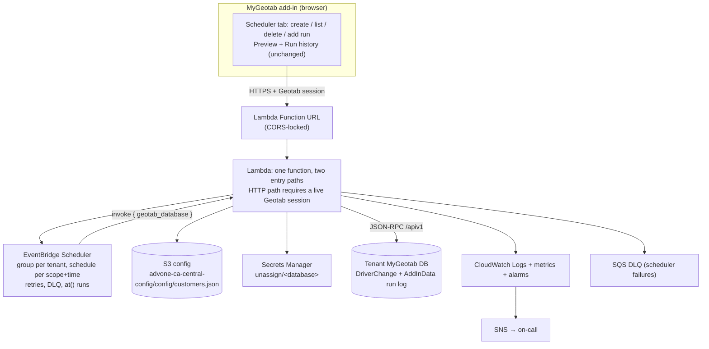

# Implementation brief — Scheduled Driver Unassign on AWS (CA + US)

> **How to use this document:** it was executed on branch `aws-lambda-port`; treat it as the
> design of record and read `docs/maintainers-guide.md` for what changed and where to edit now.
> Companion document for the legacy analysis: `docs/aws-lambda-eventbridge-port.md` (this brief
> supersedes its §5 decisions and §6 architecture; its §3 invariants still apply).
>
> **Status:** Step 0 partly done — the clearance call and its response are captured in §2, but this
> add-in's own Geotab security id and the two-user proof are still outstanding, so the shipped
> configuration denies every caller until the id is set. Steps 1–10 and 12 are implemented
> (`src/`, `test/`, `infra/`, `scripts/`, the add-in's service mode, README + guides). Step 11 —
> pilot, cutover, decommission — has not started and needs a live tenant and AWS account.

---

## 1. Mission

Move the "Scheduled Driver Unassign" service off GitHub Actions + cron-job.org onto AWS, in two
independent regional deployments (Canada = `ca-central-1`, United States = `us-east-2`), with
OpenTofu as infrastructure-as-code, one Lambda function, EventBridge Scheduler as the scheduling
engine, S3 as the runtime configuration store, and Secrets Manager per customer. Add a deploy
script that a new engineer can run with zero configuration beyond "Canada or United States", and a
customer-onboarding script that creates the secret and registers the customer in the S3 config.

Everything the product does today must keep working for the tenant: a fleet admin sets a time, and
every in-scope asset is reset to **Unknown Driver** at that time. What changes is where the work
runs (Lambda, not a CI runner), where the schedule lives (EventBridge Scheduler, not Geotab
`AddInData`), and how the user is authorized (their live MyGeotab session + the add-in's Geotab
security filters, not a shared Administrator service account).

Non-negotiables in one line each: exactly one deployment per country; no third-party cron; no
plaintext credential in the repo or in logs; schedules are per tenant and deduplicated per scope +
time; the tenant-visible features (preview, manual unassign, run history) survive unchanged.

---

## 2. Context you can rely on (verified, 2026-10-15)

| Fact | Detail |
|---|---|
| Product | Single-file MyGeotab add-in `unassignDrivers.html`; resets assets to `UnknownDriverId` at a customer-set time |
| Legacy scheduling | Schedule + run log stored in the tenant's own Geotab `AddInData` (addInId `arpL4jyXrThGH7UuWmWZXDA`); browser tab ticks every 30 s; a Node runner in GitHub Actions did the same server-side |
| Legacy trigger | cron-job.org → GitHub REST `workflow_dispatch` roughly every **15 min** (100/100 recent runs were dispatches; gaps 14.88–15.12 min; 538 runs total; the in-repo comment says 45 min, the README says 5 min — both stale) |
| Legacy auth | One repo secret `GEOTAB_ACCOUNTS` holding every tenant's Administrator service-account password |
| Legacy state | Nothing on AWS today; no IaC, no tests, no `package.json` |
| Legacy core | 505 lines of DOM-free logic (occurrence math, optimistic lock, unassign + retry, verify, log) duplicated verbatim in the add-in (lines 245–749) and the runner (lines 19–523) |
| Add-in delivery | jsDelivr pinned to a git tag (`config.json` → `v1.1.7`, current release) |
| AWS services you need | Lambda, EventBridge Scheduler, Secrets Manager, S3, IAM, CloudWatch + SNS. No VPC, no database |
| OpenTofu | Native S3 state locking via `use_lockfile` exists from **1.10**. Require ≥ 1.10, use `use_lockfile = true`; no DynamoDB lock table |

**EventBridge Scheduler limits to design around** (from the AWS API reference, verified):

- Schedule name and schedule group name: 1–64 characters, pattern `[0-9a-zA-Z-_.]+` — **`/` and `:`
  are invalid**, so a "path-like" name must be flattened (see §5.5).
- Expressions: `at(yyyy-mm-ddThh:mm:ss)` for one-time, `cron(min hours dom mon dow year)`,
  `rate(value unit)`; `ScheduleExpressionTimezone` takes an IANA zone.
- `ActionAfterCompletion: DELETE` removes a one-time schedule after it fires — always set it for
  `at()` schedules, or they accumulate toward the 10M schedules/region quota.
- `FlexibleTimeWindow` is required (`Mode: OFF` for exact-time firing); target `Input` ≤ 256 KB;
  per-schedule operation rate 10 TPS; 500 schedule groups/region; `ListSchedules` 50 TPS.
- `CreateSchedule` on an existing name returns **409 Conflict** → use `UpdateSchedule` for upserts.

**The security-filter check, captured from a live MyGeotab session** (`docs/exampleSecurityFilterCheck.txt`,
updated 2026-10-15: one `ExecuteMultiCall` with its full response. The file stays git-ignored — it
carries a customer database name and a 30-minute-lived IAM bearer token):

```json
{ "method": "ExecuteMultiCall", "params": { "calls": [
  { "method": "Get", "params": { "typeName": "Group", "search": { "id": "GroupSecurityId" } } },
  { "method": "Get", "params": { "typeName": "SystemSettings" } },
  { "method": "GetVersionInformation", "params": {} },
  { "method": "GetFeatureFlagAuthenticated", "params": { "flags": [ "…" ] } }
] } }
```

That capture came from the MyGeotab web app (headers `database: <db>`, `page-name: clearances`,
`authorization: Bearer <IAM token>`). **This service must not use the bearer path** — it passes the
caller's session in the params instead: `credentials { database, userName, sessionId }`, exactly as
the legacy client does.

Response shape is JSON-RPC: `{ jsonrpc, id, result: [ perCall0, perCall1, … ] }`, one element per
call. `result[0]` is the **array of groups**, not a single group — the capture's
`search: { id: "GroupSecurityId" }` returned **23** groups. Always select by `id`, never by index.
Each group carries:

```json
"securityFilters": [
  { "isAdd": true,
    "securityIdentifier": "SystemSettings",
    "securityId": { "customPageName": "", "isSystemSecurityId": true,
                    "version": "0000000000000003", "name": "SecurityIdSystemSettings",
                    "id": "SecurityIdSystemSettingsId" } },
  { "isAdd": true,
    "securityId": { "customPageName": "Geotab Order Addin", "isSystemSecurityId": true,
                    "name": "ViewSecurityId", "id": "acP6yyGZ42EmhgOePJfLP7w" } }
]
```

What that capture proves (use it as the contract):

- `isAdd` is the only flag present on a filter entry — no `isView`/`isEdit`/`isDelete`. Treat
  `isAdd: true` as "granted".
- `GroupSecurityId` (**Security**) holds all **294** filters and every one is `isAdd: true`: it is
  the database-wide catalog, not a per-user grant. Exclude it, or every user looks authorized.
- Clearance groups hold subsets with mixed flags: `GroupSupervisorSecurityId` 149 filters / 41 true,
  `b279D` (Manager) 56 / 18, `GroupViewOnlySecurityId` 130 / 58, `GroupDriveUserSecurityId` 64 / 45,
  `b299B` (L&L Administration) 46 / 0.
- Administrator is a single marker filter on `GroupEverythingSecurityId`:
  `{ isAdd: true, securityId: { id: "SecurityIdEverythingId", name: "SecurityIdEverythingId", customPageName: "undefined" } }`.
- Add-in filters are keyed by `securityId.id` **and** `securityId.customPageName`; they carry no
  `securityIdentifier`. In the capture: Geotab Order Addin `acP6yyGZ42EmhgOePJfLP7w`,
  Advantage One Device Management Form `a8dEwkPkfvEiBqQ4YFFsCfg`, Bulk Edit Tool
  `aXoGyYEAMVkON0T-2FmgO6A`, Data Connector `alCIkNp0MK0WuCVYu4WvLVw`, Geotab Fleet Card
  `aWrH2h8M0REWv95c0gqqO_Q`, SGS Fleet Site `aQUlmtKSNs062NFj9FwxaTA`, camera add-in
  `aA10aEA8Ebk2T1-7u3c_zUA`. **This add-in is not installed in the captured database**, so its own
  filter id has to be read elsewhere (Step 0).

User lookup, from the earlier browser capture (request side only):

```json
{ "method": "Get", "params": { "typeName": "User", "search": { "name": "<signed-in user>" },
                              "propertySelector": { "fields": ["id", "securityGroups"] } } }
```

---

## 3. Target architecture



Two deployments, identical code, separated by variables and state:

| Deployment | Region | State bucket (OpenTofu) | Config bucket (Terraform-managed) | Config key |
|---|---|---|---|---|
| Canada | `ca-central-1` | `advone-ca-central-deploy` | `advone-ca-central-config` | `config/customers.json` |
| United States | `us-east-2` | `advone-east-2-deploy` | `advone-east-2-config` | `config/customers.json` |

---

## 4. Non-negotiable requirements

| # | Requirement |
|---|---|
| R1 | **Exactly one deployment per country.** State for a region lives in exactly one bucket (`advone-<region>-deploy`), one state key, one `<config>`; the deploy script refuses to create a second one and refuses to touch a deployment created by a different AWS account unless explicitly forced. |
| R2 | **No third-party scheduler.** cron-job.org and the GitHub workflow are removed at cutover; nothing outside AWS triggers tenant work afterwards. |
| R3 | **One Lambda function per deployment** serving both the browser API path and the Scheduler invoke path. |
| R4 | **Session-based authorization.** The browser sends its MyGeotab session; the Lambda proves the session is live and that the user has view/add rights on *this* add-in via Geotab's security filters. No shared Administrator credential, no browser-side credentials, no unsigned claims from the client. |
| R5 | **Customers are data, not code.** Adding a customer = one secret + one entry in the S3 config. No redeploy, no code change. |
| R6 | **Schedules live in EventBridge Scheduler**, one schedule group per Geotab database, one schedule per scope+time; the target payload names exactly one Geotab database. |
| R7 | **Deduplication is structural.** The schedule name is derived from (database, scope, time, timezone), so a duplicate cannot be created; a repeat create is an update. |
| R8 | **The tenant's audit trail survives.** Every scheduled or manual unassign still appends a run record to the tenant's Geotab `AddInData` log, so the add-in's Run history renders without change. |
| R9 | **Never log or store secrets.** No passwords, sessions, or secret payloads in logs, error messages, plan output, or the repo. The HAR in `docs/` is git-ignored for the same reason. |
| R10 | **Deploy script works from a clean laptop**: `aws` CLI logged in, OpenTofu ≥ 1.10 installed; the only decision asked is Canada or United States. It preflights, plans, shows the plan, and applies only after explicit confirmation. Re-running with no changes is a no-op that exits 0. |
| R11 | **Fail closed on authorization.** If the add-in's security id cannot be found in the user's feature list, or its shape is unknown, deny with a clear message — never default to allow. |
| R12 | **One implementation of unassign.** The scheduled path and the manual path call the same code; the browser never contains a second copy of the unassign logic. |
| R13 | **Idempotent ops surface**: create-or-update for schedules, no-op delete of a missing schedule, retries safe because the unassign is keyed to a specific occurrence. |
| R14 | **Observability by default**: structured JSON logs, a metric per outcome (`ran`, `failed`, `skipped`, `stillAssigned`, `denied`), alarms on Lambda errors/throttles, DLQ depth, and any `failed > 0` or `stillAssigned > 0`. |

---

## 5. Contracts

### 5.1 Browser request (POST to the Function URL, `Content-Type: application/json`)

```json
{
  "action": "listSchedules",
  "session": { "database": "simplot_prod", "userName": "admin@customer.com",
               "sessionId": "<opaque>", "server": "my.geotab.com" },
  "payload": { }
}
```

Use `session.database` as the authoritative database — never a client-supplied database field.
Session material is only valid for the lifetime of the request; do not cache, log, or persist it.

### 5.2 Browser response

```json
{ "ok": true,  "action": "listSchedules", "data": { }, "warnings": [], "requestId": "<lambda request id>" }
{ "ok": false, "error": { "code": "FORBIDDEN", "message": "Your MyGeotab role has no access to this add-in." },
  "requestId": "<lambda request id>" }
```

HTTP status: 200 ok · 400 `BAD_REQUEST` · 401 `SESSION_INVALID` · 403 `DATABASE_NOT_ONBOARDED` /
`ADDIN_ACCESS_DENIED` / `CLEARANCE_REQUIRED` · 404 `NOT_FOUND` · 409 `DUPLICATE` · 500 `INTERNAL` /
`GEOTAB_ERROR`. Codes are stable strings; the add-in maps them to UI text.

### 5.3 Actions and payloads

| Action | Payload | Behaviour |
|---|---|---|
| `listSchedules` | `{}` | Lists the tenant's schedules from EventBridge, parsed and merged with their scope/timezone/kind; each item includes `name`, `arn`, `state`, `expression`, `timeZone`, `nextRun`, `scope`, `skipDriving`, `kind: "recurring" \| "one-time"` |
| `createSchedule` | `{ scope: { groupIds: [] }, mode: "daily"\|"weekly", time: "23:00", timeZone: "America/New_York", days: [1,2,3], skipDriving: true, enabled: true }` | Upsert a recurring schedule; returns `name`, `arn`, `nextRuns` |
| `updateSchedule` | `{ name, …same fields as create }` | Update in place (state, time, scope, `skipDriving`) |
| `addRun` | `{ scope, at: "2026-10-16T08:00:00", timeZone, skipDriving }` | Create a one-time `at()` schedule with `ActionAfterCompletion: DELETE`; returns `name`, `arn` |
| `deleteSchedule` | `{ name }` | Delete schedule; deleting a missing schedule is a 200 no-op with a warning |
| `unassign` | `{ scope, skipDriving?: bool, dryRun?: bool }` | Run now; returns `{ unassigned, skipped, failed, stillAssigned, rows }` counts + row detail |
| `listAssignments` | `{ scope }` | Read-only preview of assets holding a driver, with driving + HOS flags (optional if the add-in keeps its client-side preview) |
| `health` | `{}` | Version, region, config load status, customer count. No secrets |

`scope.groupIds: []` means all assets; otherwise the union of the listed Geotab groups.

### 5.4 Scheduler invoke payload (EventBridge → Lambda, trusted path)

```json
{
  "action": "unassign",
  "source": "scheduler",
  "geotab_database": "simplot_prod",
  "group_ids": ["b1234"],
  "skip_driving": true,
  "schedule_name": "all-2300-4f2a9c1d",
  "scheduled_time": "2026-10-16T03:00:00Z",
  "spec": { "mode": "daily", "time": "23:00", "timeZone": "America/New_York", "days": [], "onceAt": null }
}
```

`spec` is descriptive only: it lets `listSchedules` rebuild the plan (and the next run
time) from EventBridge alone, so no second datastore is needed. The worker ignores it and
uses the top-level fields.

Routing rule: an event carrying `requestContext` (Function URL shape) is a browser request and
**requires** a session; an event without it is a Scheduler payload and must carry
`step: "scheduler"`-grade trust. Record in the runbook that direct `lambda:InvokeFunction` rights are
equivalent to Scheduler rights, and keep them scoped to the Scheduler execution role only.

### 5.5 Naming (all names must satisfy `[0-9a-zA-Z-_.]{1,64}`)

| Thing | Pattern | Example |
|---|---|---|
| Schedule group (one per Geotab database) | `UnassignDriverSchedules-<dbPrefix>` | `UnassignDriverSchedules-simplot_prod` |
| Recurring schedule | `<scopeSlug>-<hhmm>-<hash8>` | `all-2300-4f2a9c1d` |
| Group-scoped schedule | `g<groupShort>-<hhmm>-<hash8>` | `gb1234-2300-a17c02fe` |
| One-time run | `run-<atUtcCompact>-<hash8>` | `run-20261016T0800Z-9d31be07` |
| Scope slug | `all` when `groupIds` is empty, else `g<first8OfSortedGroupId>` | `gb1234abc` |

- `hash8` = first 8 hex chars of `sha256(database + "|" + scopeKey + "|" + mode + "|" + time + "|" + timeZone)`, lowercased; `scopeKey` = `all` or the sorted group ids joined with `,`.
- `dbPrefix` = the Geotab database name lowercased, non-conforming characters replaced, truncated to 40 characters.
- The human-readable form belongs in the schedule `Description` (e.g. `All assets daily 23:00 America/New_York`).
- Because the name is derived, the same (scope, time, timezone) triple maps to the same schedule: **that is the duplicate guard**. A different scope or a different time is a different schedule and may fire at the same instant. Confirm the ambiguous case in §9 D-C.

### 5.6 S3 configuration (`s3://<config-bucket>/config/customers.json`)

```json
{
  "schemaVersion": 1,
  "deployment": { "name": "advone-ca-central", "region": "ca-central-1", "deploymentId": "<uuid>" },
  "addIn": {
    "name": "Scheduled Driver Unassign by Advantage One",
    "pageName": "Scheduled Driver Unassign",
    "securityId": { "id": "<this add-in's ViewSecurityId filter id — Step 0>", "name": "ViewSecurityId" },
    "clearance": { "requireIsAdd": true, "allowEverythingGroup": true, "ignoreCatalogGroup": true }
  },
  "defaults": { "skipDriving": true, "graceMinutes": 60 },
  "customers": {
    "simplot_prod": {
      "key": "simplot_prod",
      "geotab": { "database": "simplot_prod", "server": "my.geotab.com" },
      "secretName": "unassign/simplot_prod",
      "enabled": true,
      "timeZone": "America/New_York",
      "createdAt": "2026-10-16T00:00:00Z",
      "createdBy": "arn:aws:iam::…:user/…",
      "notes": "Optional operator note"
    }
  }
}
```

- Store the secret **name**, not its ARN: rotation and recreation keep the name stable, ARNs do not.
- The Lambda reads this object on every request (or caches for ≤ 60 s); a config change takes effect without a deploy.
- Never store a password here. Only the secret reference.

### 5.7 Secret (`unassign/<database>`, JSON, same field names as the legacy `GEOTAB_ACCOUNTS` entry)

```json
{ "database": "simplot_prod", "server": "my.geotab.com",
  "userName": "svc-unassign", "password": "<32+ char generated>" }
```

---

## 6. Authorization model (implement exactly this order)

1. Resolve the deployment config from S3.
2. Look up `session.database` in `customers`. Missing → **403 `DATABASE_NOT_ONBOARDED`** (do not fall through to "all customers").
3. Prove the session and get the caller's clearances: `Get User { search: { name: session.userName },
   propertySelector: { fields: ["id", "securityGroups", "name"] } }` with
   `credentials { database, userName, sessionId }` built from the forwarded session. Geotab error →
   **401 `SESSION_INVALID`**.
4. Resolve effective grants: for every group id in the returned `securityGroups`, read the group and
   scan its `securityFilters`. Batch them through `ExecuteMultiCall` (one
   `Get Group { search: { id: <groupId> } }` per group, ≤ 100 calls per multiCall), and select each
   group by `id` from the returned array — never by index; `Get Group` returns many groups even when
   searching one id (23 in the capture).
5. Decide, using the flags in `config.addIn.clearance`:
   - **Grant** when any filter matches this add-in — `securityId.id === config.addIn.securityId.id`
     **or** `securityId.customPageName === config.addIn.pageName` — with `isAdd === true`
     (`requireIsAdd`).
   - **Grant** when `allowEverythingGroup` and any filter has
     `securityId.id === "SecurityIdEverythingId"` with `isAdd === true` (the Administrator marker).
   - **Ignore** the group whose `id === "GroupSecurityId"` when `ignoreCatalogGroup` — it lists all
     294 filters as `isAdd: true` and carries no per-user signal.
   - Otherwise → **403 `ADDIN_ACCESS_DENIED`**. An unreadable filter shape, an empty `securityGroups`,
     or a Geotab error while reading groups is also a denial (fail closed), with a `reason` that
     names what was missing.
6. Only then execute the action, and only against the session's own database.
7. Log the decision: `{ requestId, action, database, userName, outcome: "allowed"|"denied", reason, matchedSecurityId }` — never the session id or any credential material.

---

## 7. Work plan

Each step states its deliverable, the acceptance test, and the evidence to keep. Do not start a step
whose prerequisite step's acceptance test has not passed.

### Step 0 — Pin the remaining unknowns (blocking, no code)

**Resolved by `docs/exampleSecurityFilterCheck.txt`** (updated 2026-10-15): the clearance call, its
response shape, the group/filter structure, the `isAdd` flag, the Administrator marker, and the list
of add-in filter ids — all recorded in §2 and §6. Still open:

- **This add-in's own filter id.** The capture is from a database where this add-in is not installed,
  so `config.addIn.securityId.id` must be read from a database where it is (or from MyGeotab's
  add-in management page): capture its `{ isAdd, securityId: { id, customPageName, name } }`.
- **Two-user proof, in one database.** Run the §6 decision for an Administrator and for a restricted
  user who lacks this add-in, and record both outcomes. Administrator must pass via
  `SecurityIdEverythingId`; the restricted user must be denied. If both pass, a catalog group is
  leaking into `securityGroups` — stop and re-derive the check before writing code.
- **Session shape.** Capture `api.getSession()` from a live add-in (the add-in only ever read
  `userName`; `sessionId` is unverified), then confirm the Lambda can call `Get User` with
  `credentials { database, userName, sessionId }` and get a result instead of an auth error.
- Confirm: tenant count, largest fleet size, whether existing `AddInData` schedules must be migrated,
  whether the `svc-unassign` accounts are reused, and the AWS account id(s).
- Confirm the browser origin the add-in calls from (`document.location.origin` inside the add-in
  frame) so the Function URL CORS list is exact.
- Keep redacted captures in `docs/captures/` (strip session ids, bearer tokens, customer and user
  names). `docs/exampleSecurityFilterCheck.txt` stays git-ignored as it is.
- **Acceptance:** every unknown above is answered in a written capture file; no code written yet.

### Step 1 — Repo layout and tooling

- Add `package.json` (private, runtime deps: AWS SDK v3 clients only; dev: none beyond `node --test`).
- Add this layout:

```
infra/backend/{ca,us}.hcl          # bucket + region + key (no secrets)
infra/live/{ca,us}/main.tf         # thin root: module wiring + variables
infra/modules/unassign/            # lambda, iam, function url, log group, alarms
infra/modules/tenant-schedules/    # schedule group conventions + optional bootstrap
scripts/deploy.sh                  # the one command a human runs
scripts/onboard-customer.sh        # add a tenant
scripts/offboard-customer.sh       # remove a tenant (delete secrets + schedules)
src/core/unassign-core.js          # extracted DOM-free logic (single source of truth)
src/lambda/handler.js              # entry, routing, error envelope
src/lambda/actions/*.js            # schedules, unassign, assignments, health
src/lambda/lib/*.js                # config-store, secrets, geotab client, scheduler client, logger
build/inline-core.mjs              # writes the core into unassignDrivers.html between markers
test/*.test.js                     # unit tests
```

- **Acceptance:** `npm test` runs and passes with an empty suite; `node build/inline-core.mjs` is a
  no-op on the untouched add-in (regenerating produces no diff).

### Step 2 — Extract the shared core, with tests

- Move the 505-line core out of `unassignDrivers.html` and `unassigndrivers-runner/scheduled-unassign.js`
  into `src/core/unassign-core.js`; keep the runner as a thin CLI over the same core for local
  debugging, or delete it in Step 11.
- Keep `getAssignments`, `unassign`, `run`, `appendLog` behaviourally identical (they are the
  tenant-visible contract, including the per-device `DriverChange` read pattern and the
  non-transactional multiCall retry). Delete `evaluateDue` / `claimOccurrence` from the *server*
  path once Step 11 removes browser scheduling; keep them only while the old path exists.
- Tests: DST gap and overlap for `zonedToUtc`; `occurrencesBetween` for daily/weekly/once; unassign
  batch-failure retry; verify pass populating `stillAssigned`; appendLog dedupe.
- **Acceptance:** `npm test` green; the regenerated add-in has byte-identical behaviour-bearing code;
  add-in still loads in a test database.

### Step 3 — Library layer (config, secrets, Geotab client, logger)

- `config-store.js`: read `customers.json` from the config bucket (`GetObject`), validate against a
  schema, cache ≤ 60 s, expose `getCustomer(key)`.
- `secrets.js`: `GetSecretValue` for `unassign/<key>`, cached ≤ 5 min per warm container.
- `geotab.js`: keep the existing JSON-RPC client shape (`Authenticate`, `Get`, `Add`, `Set`,
  `ExecuteMultiCall`, `path` redirect, error mapping) with an injectable `fetchImpl` so tests can
  run without the network. Never log the request body for `Authenticate`.
- `logger.js`: single JSON-line output (`level`, `requestId`, `action`, `database`, `outcome`,
  `counts`, `durationMs`), with a redact list (`password`, `sessionId`, `credentials`).
- **Acceptance:** unit tests cover config validation (missing key, bad JSON, disabled customer),
  secret caching, and Geotab error mapping, all with a fake `fetch`.

### Step 4 — Authorization module (see §6)

- **Acceptance:** table-driven tests for allowed/denied on: unknown database, invalid session,
  no `securityGroups`, this add-in's filter absent, filter present with `isAdd: false`,
  Administrator passing via `SecurityIdEverythingId`, the catalog group being ignored, a Geotab error
  while reading groups, and a filter shape that does not match the captured one (fail closed).

### Step 5 — Schedule actions

- Implement naming + hashing (§5.5), `listSchedules`, `createSchedule` (upsert via `UpdateSchedule`
  on 409), `updateSchedule`, `addRun` (`at()` + `ActionAfterCompletion: DELETE`), `deleteSchedule`
  (idempotent). Every write also ensures the tenant's schedule group exists (create-if-missing,
  tolerate 409).
- Validate inputs server-side: `HH:MM`, IANA timezone (reject unknown zones), `days` ⊆ 0–6,
  `at` in the future, `groupIds` non-empty strings; reject anything longer than the name limits
  rather than silently truncating.
- **Acceptance:** tests for the hash being stable across field order, two different scopes at the
  same time producing two schedules, same triple producing the identical name, upsert not creating a
  duplicate, and `addRun` producing a deletable one-time schedule. Live smoke in the pilot region:
  create → list → delete against a scratch database key.

### Step 6 — Unassign action (the worker)

- Scheduled invoke: read config → resolve secret → run the core `run()` with the schedule's scope
  and `skipDriving` → append the run record to the tenant's Geotab `AddInData` log (`trigger:
  "scheduled"`, `by: "Unassign Service"`, `occurrence: event.scheduled_time`) → return counts.
- Manual invoke: same worker, `trigger: "manual"`, `by: <session user>`, after the Step 4 gate.
- Preserve the old lock semantics where a second writer can still exist (open legacy add-in tabs):
  keep `claimOccurrence` on the tenant's `AddInData` schedule record during the transition, and
  delete it only after the add-in no longer schedules client-side (Step 10/11).
- **Acceptance:** with a mocked Geotab API: 100 devices → 1 multiCall batch, one failure → per-device
  retry, verify pass reports `stillAssigned`; run record appended exactly once for a repeated invoke
  of the same occurrence.

### Step 7 — Handler and HTTP surface

- Route per §5.4 (Function URL vs Scheduler). Wrap every path in the §5.2 envelope with the Lambda
  request id. Enforce a request body size limit and reject unknown actions with 400.
- Publish CloudWatch metrics per outcome and emit the structured log line; add a `health` action that
  reports version + config status without secrets.
- **Acceptance:** direct `Invoke` with a Scheduler-shaped payload runs the worker; a Function
  URL request without a session returns 401; an unknown action returns 400; no log line contains a
  password or session id (assert by test on the logger's redaction).

### Step 8 — Infrastructure + deploy script

OpenTofu, one root per region, same module, variables only:

- S3 config bucket (versioned, SSE, public access blocked, bucket-owner-enforced), pre-seeded with an
  empty `customers.json` if absent.
- Lambda: `nodejs22.x`, `arm64`, 256 MB, 300 s timeout, single function, env = config bucket name,
  region, deployment name, alarm topic.
- Lambda Function URL with CORS allowing only the add-in origins confirmed in Step 0 (methods POST,
  headers `content-type`).
- IAM role for the Lambda: `s3:GetObject` on `config/*`, `secretsmanager:GetSecretValue` on
  `unassign/*`, `scheduler:Create|Update|Delete|Get|List*` scoped to the tenant group prefix,
  `iam:PassRole` on the Scheduler role only, `cloudwatch:PutMetricData`, logs.
- Scheduler execution role: trusted by `scheduler.amazonaws.com`, `lambda:InvokeFunction` on the
  function. SQS DLQ + `DeadLetterConfig` on every schedule target, `RetryPolicy` bounded (e.g.
  2 attempts / 1 h max age).
- Log group with retention, alarms (Lambda `Errors`, `Throttles`, DLQ depth, custom
  `failed > 0`, `stillAssigned > 0`, `denied` spike), SNS topic with an email subscriber list from a
  variable.
- `infra/backend/{ca,us}.hcl` with `use_lockfile = true` (OpenTofu ≥ 1.10).
- **`scripts/deploy.sh`** — the whole of R10:
  1. `set -euo pipefail`; parse `--region ca|us`, `--yes` (non-interactive), `--plan-only`, `--force`, `--destroy`.
  2. Preflight: `aws`, `tofu`, `jq` present; `tofu version` ≥ 1.10; `aws sts get-caller-identity` succeeds; region matches the chosen deployment; `aws scheduler list-schedule-groups --region <r>` succeeds (proves usable credentials).
  3. Bootstrap the state bucket `advone-<region>-deploy` if missing (versioning, SSE, public access block, `BucketOwnerEnforced`) and write/verify the ownership marker (`{ deploymentName, region, accountId, createdAt, createdBy }`). Abort with a clear, actionable message if the marker disagrees with the current account/region unless `--force`. The deploy buckets host more than one Advantage One service, so every object this service owns lives under the `scheduled-driver-unassign/` prefix — state, the state lock OpenTofu writes beside it, and the marker — and the script's listing and ownership guards are scoped to that prefix so another service's state is never counted or touched. It also refuses to run when this service's state still sits at the pre-prefix key and prints the `aws s3 mv` that migrates it.
  4. `tofu init -reconfigure -backend-config=infra/backend/<region>.hcl`.
  5. `tofu plan -out=deploy.tfplan`; print a human summary (adds/changes/destroys, with destroys highlighted).
  6. Prompt: apply? (`--yes` skips). Then `tofu apply deploy.tfplan`.
  7. Post-apply: `tofu output -json`, then smoke-test by invoking `{"action":"health"}` and print the
     endpoint URL, config bucket, tenant group prefix, alarm topic, and the exact next command
     (`scripts/onboard-customer.sh --region <ca|us>`).
  8. Idempotency: a second run with no changes must print "No changes" and exit 0.
  9. Refuse to deploy the *other* region's resources into this deployment; refuse a second state key.
- **Acceptance:** from a clean checkout on a machine with credentials, `scripts/deploy.sh` completes
  and prints the health output; re-running is a no-op; running it a third time in a different shell
  at the same time is blocked by the state lock, not by a double apply. `tofu destroy` is only
  reachable behind `--destroy` + typed confirmation.

### Step 9 — Customer onboarding script

- **`scripts/onboard-customer.sh [--region ca|us]`** asks, in order: Geotab database name, server
  (default `my.geotab.com`), service-account user name, password (silent, confirmed, 32+ chars
  enforced or generated and shown once), timezone (default from the deployment), optional notes.
- Verifies credentials with a live `Authenticate` (and a `Get User` for the account) **before**
  writing anything; on failure, exit non-zero with no side effects.
- Creates/updates the Secrets Manager secret `unassign/<database>`; updates
  `config/customers.json` with a read-modify-write using S3 conditional put (`If-Match` on the
  ETag) and retries on conflict, so two operators onboarding simultaneously cannot clobber each
  other.
- Prints the resulting secret name, customer key, and the deployed tenant schedule-group name.
- `scripts/offboard-customer.sh` reverses it: disable the entry (keeps the audit trail), delete the
  tenant's schedules only after confirmation, optional secret deletion.
- **Acceptance:** onboarding a scratch database twice is idempotent (second run updates rather than
  duplicates); a wrong password exits before any AWS write; a stale-ETag write is retried and does
  not lose a concurrently added customer.

### Step 10 — Add-in client changes

- Add a small client module to the add-in that POSTs `{action, session, payload}` to the Function URL,
  mapping error codes to the existing UI messages; keep the tabs, tables and copy as-is.
- Session source: `api.getSession(cb)`; send only `{database, userName, sessionId, server}`. Never
  send a password.
- Scheduler tab now: list from `listSchedules`, save via `createSchedule`/`updateSchedule`, delete via
  `deleteSchedule`, "Run now" → `addRun`, and the manual button → `unassign`.
- **Remove the client-side scheduler** (the 30 s tick and the `AddInData` schedule writes) once Step
  11 confirms EventBridge fires reliably; keep the `AddInData` run-log read for Run history.
- Keep the preview table client-side (the browser already has the Geotab API) unless
  `listAssignments` turns out to be needed for parity — decide in §9 D-E.
- **Acceptance:** in a test database, create/list/delete a schedule and run a manual unassign through
  the UI; a non-admin without add-in access sees the denial path; the Run history table shows the
  Lambda-triggered run.

### Step 11 — Pilot, cutover, decommission

- Pilot one tenant in the target region: create its secret + config entry, create one schedule, watch
  one occurrence fire in the tenant's local timezone, verify the run record and the assets.
- Verify authorization against a real non-admin user and a real admin.
- Cut over: disable the cron-job.org job, delete `.github/workflows/scheduled-unassign.yml`, delete
  the inert root `scheduled-unassign.yml`, remove the duplicate runner README, and retire the
  client-side scheduler in the add-in (new add-in release, new jsDelivr tag).
- Migrate existing `AddInData` schedules if Step 0 said they must be migrated (one-time script:
  read each tenant's saved schedule → create the equivalent EventBridge schedule → disable the
  AddInData schedule so it cannot double-fire).
- **Acceptance:** a slot fires with GitHub Actions fully retired; exactly one run record per slot;
  no tenant has two schedules for the same scope + time.

### Step 12 — Documentation

- Rewrite the repo README around the AWS deployment (what it is, how to deploy, how to onboard a
  customer, how to run a manual unassign, how to read alarms) and keep the add-in install/release
  sections.
- Runbook: deploy both regions, rotate a customer credential, onboard/offboard, respond to each
  alarm, force-run a schedule for testing, roll back (redeploy previous state, or re-enable the
  legacy path if the pilot demands it), and how to disable all schedules for one tenant in an
  emergency.
- **Acceptance:** a second engineer onboards a scratch customer and removes it again using only the
  README + runbook.

---

## 8. Verification checklist (end-to-end, before calling this done)

| # | Check | Evidence |
|---|---|---|
| 1 | Both regions deployed from the same commit; `scripts/deploy.sh` is a no-op on re-run | terminal transcript |
| 2 | A second deployment attempt in the same country is refused with an actionable message | transcript |
| 3 | Schedule created via the add-in fires at the tenant's wall-clock time (DST-correct for a `America/Toronto` and an `America/New_York` tenant) | schedule + run record timestamps |
| 4 | Duplicate create for the same scope+time updates, never duplicates | `listSchedules` output |
| 5 | Two different scopes at the same time both fire | two run records |
| 6 | One-time run fires once and the schedule self-deletes | `listSchedules` after the run |
| 7 | Manual unassign from the add-in matches the scheduled path (same code, same report) | run records |
| 8 | Non-admin / no-add-in-access user is denied; admin allowed | denial log line + UI message |
| 9 | `health` works with no session and leaks nothing | response body |
| 10 | No secret, password, or session id appears in CloudWatch logs | log query |
| 11 | Alarm fires for a forced failure (bad secret for a scratch tenant) and does not affect other tenants | SNS email + logs |
| 12 | Scheduler failure is captured in the DLQ with the payload intact | DLQ receive |
| 13 | Add-in Run history renders new Lambda runs unchanged | screenshot |
| 14 | Legacy trigger retired: zero workflow runs after cutover | GitHub API query |

---

## 9. Decisions to confirm before coding

| # | Question | Recommendation |
|---|---|---|
| D-A | Are the two deployments in one AWS account (two regions) or two accounts? | One account, two regions — the script picks the region, and the state bucket pins the instance |
| D-B | Config bucket naming (`advone-ca-central-config`) and state bucket (`advone-ca-central-deploy`) as written | Keep as written; state bucket is created by the script, config bucket by Terraform |
| D-C | Duplicate rule for identical one-time runs at the same instant for the same scope | Reject with 409 `DUPLICATE`; allow the same scope at different times, and different scopes at the same time |
| D-D | Do existing `AddInData` schedules get migrated? | Yes, one-time migration in Step 11, with the old schedule disabled so it cannot double-fire |
| D-E | Keep the client-side preview, or move it to `listAssignments`? | Keep it client-side (zero-latency, no extra API surface); expose `listAssignments` anyway for ops |
| D-F | How does an Administrator pass the clearance check? | Via the `SecurityIdEverythingId` marker on their Everything group (`allowEverythingGroup: true`); every other clearance group must carry this add-in's filter with `isAdd: true` |
| D-G | Where does the run history live? | Keep appending to the tenant's Geotab `AddInData` log (tenant-owned audit, zero UI change) |
| D-H | Leave the add-in's own scheduler as a fallback? | No — remove it; two schedulers create double-run risk and EventBridge is authoritative |
| D-I | One schedule group per Geotab database (500/region quota) or a single group with prefixed names? | Group per database while tenant count is low; revisit if it approaches 400 |
| D-J | Exclude the 294-filter catalog group `GroupSecurityId` from grant computation? | Yes (`ignoreCatalogGroup: true`) — the capture shows every filter there as `isAdd: true`, so trusting it would authorize every user |

---

## 10. Out of scope — do not build

- No UI redesign, no rebranding, no changes to the add-in's copy or the service-account instructions tab (beyond removing text that says GitHub Actions).
- No moving the run log into DynamoDB, no analytics pipeline, no dashboards beyond the alarms in §7 Step 8.
- No changes to what "unassign" does at the Geotab API level (still a `DriverChange` to `UnknownDriverId`).
- No multi-region failover, no cross-region replication, no per-tenant AWS accounts.
- No new third-party service in the critical path.

## 11. Definition of done

- Two deployments exist, one per country, each with one Lambda, one config bucket, one state bucket,
  alarms wired to a real recipient, and no dependency on GitHub Actions or cron-job.org.
- A brand-new engineer with AWS CLI access can deploy by answering "Canada" or "United States", and
  can onboard a customer with one script.
- Every tenant operation the add-in offered before the port still works, now authorized by the
  user's own MyGeotab session and the add-in's Geotab security filter.
- Schedules are deduplicated by construction, one schedule group per tenant database, and each
  scheduled invoke names exactly one Geotab database.
- No secret, password, or session value exists in the repo, in plan output, or in logs.
- README + runbook let someone else operate it without asking the author.
