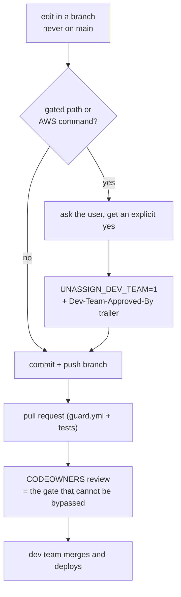

# The change gate: who may change what

This repository is edited by people who are not on the development team — for the add-in's screen,
its wording, its layout. It also contains, in the same tree, the AWS service that runs the schedules:
a Lambda per region, EventBridge Scheduler, S3 config and run-log buckets, Secrets Manager, and the
OpenTofu that owns all of it. The gate exists so the first group cannot break the second by accident.

Agents read the same rules from [`AGENTS.md`](../AGENTS.md) (Oh My Pi, Claude Code, and Codex all load
it; `CLAUDE.md` and `.omp/AGENTS.md` point at it), and the rules are enforced by code, not by asking
politely.

## Two zones

| Zone | Paths | Who |
|---|---|---|
| **Open** | `unassignDrivers.html` outside the `BUILD:core` / `BUILD:client` markers, `translations/`, `docs/`, `README.md` | anyone, including non-technical staff |
| **Gated** | `infra/` `src/` `build/` `scripts/` `test/` `unassigndrivers-runner/` `scheduled-unassign.yml` `.github/` `.githooks/` `.omp/` `.claude/` `AGENTS.md` `CLAUDE.md` `package.json` `pnpm-lock.yaml` `config.json` `config.ca.json` `config.us.json` `config.pages.json` | dev team, with the confirmation below |

Two reasons a path is gated rather than open:

- **`src/core/unassign-core.js` runs twice.** It is the schedule math in the Lambda *and* — copied in
  by `build/inline-core.mjs` — the same code in the page the browser loads. Editing the copy inside
  `unassignDrivers.html` looks like a UI change and is a service change.
- **Most of `scripts/` mutates live AWS.** `deploy.sh` plans and applies OpenTofu, then publishes the
  add-in; `onboard-customer.sh`, `offboard-customer.sh`, and `seed-test-fleet.sh` write secrets,
  config records, and schedules in real accounts.

The guard's own files (`.githooks/`, `scripts/guard/`, `.claude/settings.json`, `.omp/hooks/`) are
gated too: a refusal must not be editable away by the party being refused.

## What the confirmation is

Two things, both asserted by the human — never by the agent, and never persisted between commands:

```bash
UNASSIGN_DEV_TEAM=1 git commit -m "…" --trailer "Dev-Team-Approved-By: Jordan"
UNASSIGN_DEV_TEAM=1 git push -u origin infra/short-slug
UNASSIGN_DEV_TEAM=1 scripts/deploy.sh --region ca
```

The environment variable is the permission; the trailer is the record of who gave it, and it is what
the pull-request check reads. Agents are told (in `AGENTS.md` §3) to ask this question first and to
proceed only on an explicit yes:

> "This change touches `<paths>`, which controls the AWS side of the app (the Lambda service, its
> OpenTofu infrastructure, or the tooling that deploys them). Are you on the dev team, and do you
> want this change to go ahead?"

## How a change travels



## Enforcing it in a checkout

| Gate | Where | Catches |
|---|---|---|
| Agent tool gate | `.claude/settings.json` → `scripts/guard/claude-pre-tool-use.mjs` | Claude Code edits and shell commands before they run |
| Agent tool gate | `.omp/hooks/pre/guardrails.ts` | Oh My Pi's `edit` / `write` / `ast_edit` / `bash` calls |
| Git hooks | `.githooks/{pre-commit,commit-msg,pre-push}` | any author, any agent, any editor: no commits on `main`, no gated change without the confirmation, no stale add-in, no state or secrets |
| Pull-request check | `.github/workflows/guard.yml` → `scripts/guard/ci-check.mjs` | the same rules on the commits a pull request introduces, plus `node --test test/*.test.js` |
| Review gate | `.github/CODEOWNERS` + branch protection | merging to `main` without a dev-team approval |

Install the hooks once per clone — `pnpm install` does it for you, or run it directly:

```bash
pnpm run hooks:install        # git config core.hooksPath .githooks
```

They are not copied into `.git/hooks`, so every branch and worktree of the clone runs the reviewed
hooks rather than a stale copy.

## Dev-team setup checklist (once, in GitHub)

1. **Settings → Branches → `main`**: require a pull request, require review from Code Owners, and
   disallow force pushes. This is the only layer a determined author cannot bypass locally.
2. Replace `@jordan-advone` in `.github/CODEOWNERS` with the dev team's GitHub team if there is one.
3. Keep `guard.yml` required for merging; it re-checks what the local hooks checked.

## What the gate deliberately does not do

- **It does not prompt.** A prompt would hang agents and CI, and an unanswerable prompt fails open.
  The confirmation is an explicit switch the human types.
- **It is not a sandbox.** A local hook can be bypassed with `--no-verify`, and an agent can put
  `UNASSIGN_DEV_TEAM=1` in front of its own command. That is why the trailer, the pull-request check,
  and CODEOWNERS exist: they are server-side, and they leave a record.
- **It does not gate reads.** `aws … describe/list`, `tofu plan`, `tofu validate`, and `pnpm test` are
  always allowed.

## Changing the zones

Edit `PROTECTED_PATHS` or `FORBIDDEN_PATTERNS` in `scripts/guard/policy.mjs` — every gate reads that
one list — and update `.github/CODEOWNERS` to match. Both are themselves gated changes, so the edit
goes through the same confirmation as the paths it governs.
