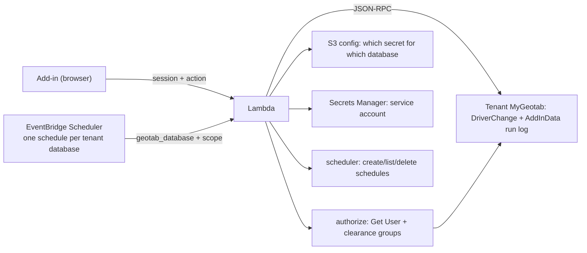

# Maintainer's guide: what changed, and how to change it now

For whoever built the original add-in and the GitHub Actions runner. The product behaves the same
for a customer; almost everything about how it is built and where it runs has changed. This page is
the shortest path back to being able to modify it safely.

Read this first, then [`docs/aws-deployment-guide.md`](aws-deployment-guide.md) for operating it, and
[`docs/aws-port-implementation-prompt.md`](aws-port-implementation-prompt.md) for the design brief
the rewrite followed.

---

## 1. What changed

| Before | Now | Why |
|---|---|---|
| Schedule and run log both in Geotab `AddInData`; the add-in ran schedules from an open tab | Schedules in **EventBridge Scheduler**; runs execute in a **Lambda**, so they fire with nobody signed in | Removing the "someone must have MyGeotab open" failure mode was the whole point |
| Triggered by cron-job.org → GitHub Actions (`workflow_dispatch`) | Triggered by EventBridge Scheduler calling the Lambda directly | No third-party cron, no CI runner, no 15-minute cadence, no 60-day public-repo schedule pause |
| Every tenant's Administrator password in one repo secret | One **Secrets Manager** secret per tenant, one entry per tenant in an S3 config object | Blast radius and rotation |
| Access gated by "is this user an Administrator?" (`checkAdmin`) | Gated by the caller's **own MyGeotab session** plus the add-in's **Geotab security filter** (`isAdd`) | A viewer with no access to the add-in is now refused; no shared service account is used for user actions |
| 505 lines of schedule math copy-pasted between the add-in and the runner, plus a `build.js` that did not exist | One source file `src/core/unassign-core.js`, **inlined into the add-in at build time** | The two copies could silently diverge; now `npm test` fails if they do |
| No tests, no `package.json`, no IaC | `npm test` (101 tests, no network/AWS/tenant needed), OpenTofu, deploy and onboarding scripts | The schedule math and the retry logic were the risky parts and had no coverage |
| Run log written by whoever ran the unassign | **Still written to the tenant's Geotab `AddInData`**, by the Lambda | It is the tenant's audit trail and the add-in's Run history; nothing had to change there |

The add-in's UI, copy, tabs, preview table and Run history are unchanged. What is new is a
**Scheduled runs** card (visible only when the service is configured) and the fact that saving a
schedule now writes to AWS instead of to Geotab.

## 2. The one rule to remember

`unassignDrivers.html` contains two generated regions:

```
/* BUILD:core:begin */   … the 505-line shared core, from src/core/unassign-core.js
/* BUILD:client:end */   … the service client, from src/addin/api-client.js
```

**Never edit inside those markers.** Edit the file in `src/`, then:

```bash
npm run build:addin      # regenerates the regions in unassignDrivers.html
npm test                 # fails loudly if the built file is stale
```

Everything else in the HTML (markup, styles, the UI script) is hand-edited as before.

## 3. Repository map

| Path | Kind | What it is |
|---|---|---|
| `unassignDrivers.html` | built + hand-edited | The add-in: markup, styles, UI script (hand), core + client (generated) |
| `src/core/unassign-core.js` | source | Schedule math, DST conversion, the cross-writer lock, unassign + retry, verify, Run log. Runs in the browser **and** in the Lambda |
| `src/addin/api-client.js` | source | Browser client for the service (envelope, error codes, timeouts) |
| `src/lambda/handler.js` | source | Entry point; routes browser requests vs Scheduler invocations |
| `src/lambda/actions/` | source | `schedules`, `unassign`, `assignments`, `health`, `auth` |
| `src/lambda/lib/` | source | `naming`, `scheduler`, `geotab`, `config-store`, `secrets`, `logger`, `errors` |
| `src/lambda/aws.js` | source | The only file that imports the AWS SDK (lazily) |
| `build/inline-core.mjs` | tool | `--check` verifies, without it regenerates |
| `test/` | tests | `npm test`; fakes live in `test/support/fakes.js` |
| `infra/modules/unassign` | IaC | Lambda, IAM, Function URL, config bucket, DLQ, SNS, alarms, metric filters |
| `infra/live/{ca,us}` | IaC | Thin roots: region + names only |
| `scripts/` | tooling | `deploy.sh`, `onboard-customer.sh`, `offboard-customer.sh`, shared `lib/common.sh` |
| `scheduled-unassign.yml`, `.github/workflows/` (removed at cutover) | deleted | The old trigger; see §6 |
| `config.json` | published | Add-in configuration (jsDelivr tag + version) |

## 4. How the two paths work



- **Browser request** → `handler.handleHttp` → config lookup by `session.database` → `authorize`
  (session proof + clearance) → the action. Answers with `{ok, action, data}` or
  `{ok:false, error:{code, message}}`.
- **Scheduler invocation** → `handler.handleScheduled` → config lookup by `geotab_database` → secret
  → the same unassign worker. Failures are thrown on purpose: that is what makes Scheduler retry,
  the DLQ capture the payload, and the alarm fire.

Action names and payloads: implementation brief §5.3. The schedule's storage *is* the Scheduler
target payload (`spec` inside it), so there is no database to keep in step.

## 5. Recipes

Every recipe ends with the check that proves it. Run `npm test` before you push; it is fast and
needs nothing external.

**Change what a run does** (the unassign algorithm, batching, verification)
1. Edit `src/core/unassign-core.js` (or `getAssignments`/`unassign`/`run`).
2. Add or adjust a test in `test/core.test.js` using `createCoreApi()` from `test/support/fakes.js`.
3. `npm test && npm run build:addin`.

**Add a schedule option** (for example "skip assets that are not reporting")
1. Validate and normalise it in `src/lambda/actions/schedules.js` (`buildPlan`).
2. Carry it in the Scheduler payload: `buildInput`/`parseInput`/`toView` in
   `src/lambda/lib/scheduler.js`, and the `spec` shape.
3. Apply it in the worker (`src/lambda/actions/unassign.js`) or the core.
4. Add the control to the add-in form and to `serverSchedulePayload()` in `unassignDrivers.html`
   (outside the markers), plus the legacy `readForm()` if the legacy path must keep working.
5. Tests: `test/schedules.test.js` (plan), `test/scheduler.test.js` (payload round-trip),
   `test/unassign.test.js` (effect).

**Add an API action**
1. Add the code to `STATUS_BY_CODE` in `src/lambda/lib/errors.js` if it introduces one.
2. Implement it in `src/lambda/actions/<name>.js`; register it in `ACTIONS` in
   `src/lambda/handler.js` (`auth: false` only for session-free actions like `health`).
3. Add a method to `src/addin/api-client.js` and a friendly message to its `ERROR_TEXT` map.
4. Wire the UI, and cover it in `test/handler.test.js`.

**Change a schedule's name or the duplicate rule**
`src/lambda/lib/naming.js` only. The name *is* the deduplication key, so a change there orphans
existing schedules — migrate them deliberately (list, create, delete) rather than changing the rule
in place.

**Change the authorization rules**
`src/lambda/actions/auth.js` and the `addIn.clearance` block in the tenant config
(`requireIsAdd`, `allowEverythingGroup`, `ignoreCatalogGroup`). Update the table-driven tests in
`test/authorize.test.js`, and re-run the two-user proof in the deployment guide §2.2 — the catalog
group (`GroupSecurityId`) must never be trusted: it lists every filter as `isAdd: true`.

**Change scheduling behaviour** (cadence, retries, DLQ, alarms, CORS)
`infra/modules/unassign` variables and, for the alarm subscriber, `alarm_email` in
`infra/live/<region>`. Then `scripts/deploy.sh --region <r>` (it plans first). CORS origins come
from `ALLOWED_ORIGINS`.

**Where state lives.** The two `advone-<region>-deploy` buckets are shared with other Advantage One
services, so this service owns everything under the `scheduled-driver-unassign/` prefix: state,
lock file, ownership marker. The prefix is one constant (`SERVICE_SLUG` in `scripts/lib/common.sh`)
and `infra/backend/{ca,us}.hcl` must declare the same key; the deploy script refuses to `init` if
they disagree, and its "other state" guards only ever look under the prefix. Renaming the slug is a
state migration (`aws s3 mv`), not an edit.

**Change the browser contract** (envelope, status codes, CORS behaviour)
`src/lambda/http.js` plus `test/handler.test.js`, and keep `src/addin/api-client.js` in step.

**Release the add-in**
Bump `version` in `config.json`, run `npm run build:addin`, commit, publish a **new** tag matching
the version (`v2.0.1`) — jsDelivr caches tags forever, so never move one.

**Onboard, rotate or offboard a tenant**
`scripts/onboard-customer.sh`, `offboard-customer.sh`; both have `--dry-run`/`--selftest`, and
`scripts/deploy.sh --selftest` covers the pure helpers of all three.

## 6. Still legacy, and how to finish it

- **The add-in's own scheduler** (`tick`, `claimOccurrence`, `core.saveSchedule`) is still in the
  file and is used when `SERVER_API_BASE` is empty. In service mode it is inert: `tick()` returns
  immediately and the grace/wake-lock controls are hidden. Once every tenant runs in service mode,
  delete `tick`, `startTimers`, the wake-lock code and the legacy `startServerMode` branch
  (`onSave`/`onRunNowConfirm`), then re-run `npm test`.
- **The migration lock.** While both schedulers can run, a scheduled Lambda run claims the
  occurrence on the tenant's `AddInData` schedule record (the same lock the add-in uses), so a slot
  cannot run twice. When no tenant keeps a client-side schedule, delete that block from
  `src/lambda/actions/unassign.js` (`claimOccurrence`) and the corresponding test.
- **The old trigger.** `scheduled-unassign.yml` at the repo root was inert even before this rewrite
  (GitHub only reads `.github/workflows/`); `.github/workflows/scheduled-unassign.yml` is now
  dispatch-only and driven by cron-job.org. Disable the cron-job.org job, confirm no further runs,
  then delete both files and the duplicate `unassigndrivers-runner/` README. The `unassigndrivers-runner/`
  JavaScript is superseded by `src/lambda` + `src/core` and can go with it.
- **`config.pages.json`** points at a GitHub Pages site that does not exist (`has_pages: false`).
  Delete it unless Pages is coming back.

## 7. Traps that will bite

1. **EventBridge names** are `[0-9a-zA-Z-_.]{1,64}` — no `/`, no `:`. Hence
   `UnassignDriverSchedules-<db>` groups and `<scope>-<HHMM>-<hash8>` schedules.
2. **`RetryPolicy` and `DeadLetterConfig` belong inside `Target`**, not at the top level of
   `CreateSchedule`/`UpdateSchedule`. Getting this wrong fails only at apply time.
3. **One-time runs** are converted from the tenant's wall clock to UTC by the Lambda, then written
   as `at(...)` with **no** `ScheduleExpressionTimezone` — otherwise EventBridge reinterprets the
   instant. A `Z` or an offset in the input is rejected rather than guessed.
4. **`Get Group` returns many groups** even when searching one id (23 in the live capture). Always
   select by `id`.
5. **`skipped` is a count** of driving assets left alone; the "this run deliberately did nothing"
   signal is `skippedReason`. The handler uses that to decide between `ran`, `idle` and `failed`.
6. **The lock id must be unique per invocation** (`lambda-<requestId>`). Two runners sharing an id
   would each see their own write and both proceed.
7. **The run log stays in Geotab `AddInData`** (`trigger`, `occurrence`, `by: "Unassign Service"`).
   The add-in renders it; do not move it without a plan for the tenant-facing history.
8. **No runtime dependencies.** The Lambda artifact is `zip -qr dist/lambda.zip src` and the
   runtime supplies AWS SDK v3. Adding a dependency means changing the deploy script's build step.
9. **Tests clone their fixtures.** `test/support/fakes.js` deep-copies what you pass in, so a test
   that writes does not leak into the next one; pass shared objects knowingly.
10. **The add-in UI wiring has never been exercised against a live MyGeotab** (see §8). Treat the
    service-mode card as the least-verified part of the system.
11. **The deploy buckets are shared.** Never list, guard or clean up objects in
    `advone-<region>-deploy` without the `scheduled-driver-unassign/` prefix — another service's
    state may be sitting next to ours. `state_keys()` in `scripts/deploy.sh` is prefixed for exactly
    this reason, and `check_legacy_state_key` stops a pre-prefix deployment from being created twice.

## 8. What is verified, and what is not

| Area | Status |
|---|---|
| Shared core (DST math, due/missed, lock, unassign + retry, verify, log) | 12 tests, incl. spring-forward gap and a non-transactional batch failure |
| Schedule naming, dedup, cron/at expressions, plan validation | tested (`test/naming.test.js`, `test/schedules.test.js`) |
| Scheduler wrapper (create → update on conflict, DLQ/retry placement, list, delete, next-run) | tested against an in-memory Scheduler client |
| Authorization decision (Everything marker, add-in filter, revoked, catalog trap, group selected by id, failures) | tested (`test/authorize.test.js`) |
| Handler routing, envelope, CORS, session gate, scheduler path outcomes | tested (`test/handler.test.js`) |
| Config/secret validation, caching, redaction | tested |
| Add-in build integrity (regions match `src/`, markers intact, globals present) | tested |
| OpenTofu for both regions | `tofu fmt -check` clean; `tofu validate` passes in `infra/live/ca` and `infra/live/us` (no apply: no credentials here) |
| Scripts | `bash -n` clean; 50 + 52 + 20 self-test assertions pass (state-key prefix, backend-config/key agreement, lambda artifact and the plan-summary conversion); the plan summary was also exercised against a real `tofu plan` + `tofu show -json`; live AWS paths not exercised |
| Add-in server-mode card (create/list/edit/delete/run-now) | **Not verified against a live MyGeotab.** Syntax-checked, every element id it references exists, and the client it uses is unit tested — but it needs a real database to be called done |
| Clearance against real users | **Not verified.** Needs the two-user proof in the deployment guide §2.2, which is also what proves `addIn.securityId.id` is right |

## 9. Running things locally

```bash
npm test                              # 101 tests, offline
npm run build:addin                   # regenerate the add-in's generated regions
npm run check:addin                   # fail if the add-in is stale
tofu fmt -check -recursive infra && (cd infra/live/ca && tofu validate)
scripts/deploy.sh --selftest          # the script's pure helpers, offline
scripts/deploy.sh --region ca         # real deploy: needs an AWS login
```

Adding a test: put it in `test/<area>.test.js`, import the module directly, and build the world in
memory with the helpers in `test/support/fakes.js` (`createCoreApi`, `createFakeGeotab`,
`createFakeSchedulerClient`, `createFakeConfig`, `createFetch`, `createGeotabFetch`). Nothing in the
test suite touches the network, AWS, or a Geotab tenant, and it must stay that way.
